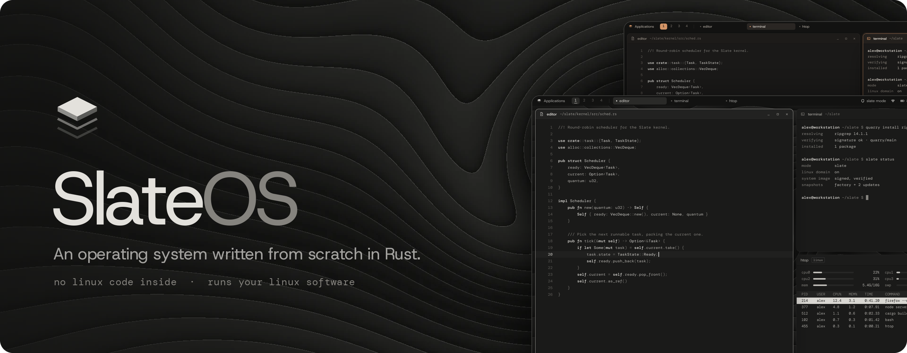

<p align="center">
  
</p>

# SlateOS

SlateOS is an open-source, x86-64, Unix-like operating system written from
scratch in Rust. It contains no Linux, BSD or UNIX code, yet it runs
existing Linux software unmodified by implementing the Linux system-call
interface from documentation. Its kernel, base system, desktop and tools
are its own.

Its aim is to be the system you could boot, if the Linux ecosystem ever
broke down, and keep working on: your tools, compilers, containers,
Flatpak apps and Linux drives, on a kernel and base system that are
entirely its own; and, beyond that, a clean slate: minimal, fast and
modern, with nothing preinstalled beyond the basics.

> [!WARNING]
> **SlateOS is alpha software. Don't use it in production.** It is early
> and changing quickly: expect bugs, crashes, missing features and data
> loss, and changes between releases that break what worked before.
> Don't run it on a computer, or with files, you can't afford to lose:
> try it in a virtual machine or on a spare disk, and back up first.

Website: **[neuralpunk.github.io/slate-os](https://neuralpunk.github.io/slate-os/)**

## What it does today

- **Runs Linux programs unmodified:** static and dynamic ELF, threads,
  signals, namespaces, containers (podman, docker), GCC, Clang, Rust,
  Python, git, OpenSSH, Firefox and Flatpak apps.
- **Its own kernel:** SMP scheduling, copy-on-write memory, a page cache,
  ext4 and SlateFS (its own copy-on-write file system with snapshots),
  NVMe, AHCI, USB, networking with IPv4 and IPv6, an nf_tables firewall,
  ACPI through its own AML interpreter, and its own AMD display and 2D
  drivers.
- **Its own userland:** the chalk shell, coreutils, slinit, an editor, a
  pager, quarry (the package manager), an SSH server, a TLS client, a C
  library, and the installers.
- **Slate mode by default:** a signed, immutable system image, atomic
  updates with rollback, per-app permissions and disk encryption, with
  Linux compatibility mode one switch away.
- **Strata, its own desktop:** windows, a top bar, a launcher, themes and
  Slate's own apps (Files, Settings, a terminal, a text editor, App
  Center and more).
- **Its own bootloader**, slate-loader, for UEFI and BIOS.

## Building

On Linux, with [rustup](https://rustup.rs), git, a C compiler and
binutils (`make deps` checks, and says how to install what's missing):

```sh
make            # both install media: target/slate-usb.img and target/slate.iso
make usb        # only the USB image
make iso        # only the ISO
make run        # boot SlateOS in QEMU (needs qemu-system-x86 and OVMF)
make help       # every target
```

The first build installs the pinned Rust nightly (from
`rust-toolchain.toml`) and fetches the Limine bootloader for the ISO;
it takes a few minutes. Write `slate-usb.img` to a USB stick raw (with
`dd` or GNOME Disks) to install SlateOS on a PC. Everything is built by
`cargo xtask`, which the Makefile calls: `cargo xtask run`, `test` and
`check` work directly too.

[guides/INSTALL.md](guides/INSTALL.md) installs it on a PC, and
[guides/getting-started.md](guides/getting-started.md) shows the desktop
and the command line (both are also in the system's Help).

## Repository layout

| Directory | What it holds |
|---|---|
| `kernel/` | The kernel (`x86_64-unknown-none`) and its vDSO |
| `boot/` | slate-loader, the bootloader: `core` (host-tested), `uefi`, `bios` |
| `libs/` | `no_std` libraries, unit-tested on the host: file systems, the network stack, ACPI, GPU, formats, crypto glue |
| `userland/` | Slate's own programs, one crate each, on the `rt` runtime |
| `rootfs/`, `rootfs-live/` | Files for the system image, and the live medium's overrides |
| `assets/` | Fonts (OFL-1.1) |
| `tests/` | Test programs, shell scripts, GNU comparisons, acceptance projects |
| `tools/` | `xtask` (builds, images, QEMU runs, tests), `slate-cc`, target specs |
| `guides/` | The user guides: installing, getting started |
| `site/` | The website, deployed to GitHub Pages by `.github/workflows/pages.yml` |

## Principles

Clean-room: no Linux, BSD or UNIX code is copied, translated or read for
the subsystem being written; Linux interfaces are implemented from
man-pages, specifications and observed behaviour. Third-party crates
are few, permissively licensed and pinned (the crypto primitives, the
Limine protocol's structures); Slate's native system-call interface is
described in [libs/abi/native-abi.md](libs/abi/native-abi.md).

## License

Licensed under either of [Apache License, Version 2.0](LICENSE-APACHE) or
[MIT license](LICENSE-MIT) at your option. Bundled data keeps its own
licence: the fonts OFL-1.1 (`assets/fonts`), Mozilla's root
certificates MPL-2.0, the Unicode Character Database's tables the
Unicode License, xkeyboard-config's layouts MIT; the tz database is in
the public domain.
